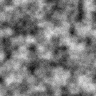

# Лабораторная работа № 1

**Подготовка рабочей среды и паспорт воспроизводимого AI-эксперимента**  
Дисциплина: «Искусственный интеллект в креативных технологиях».  
Вариант: **23 — водная рябь, квантование до 4 бит**.  
Выполнил: **Король Алексей Юрьевич**. Группа: **Т26ИИКТ-МИМО11**.  
Учебное заведение: **Донской государственный технический университет (ДГТУ)**.  
Дата запуска: 11.10.2026 17:28:50 .

## 1. Цель и постановка

Цель работы — настроить отдельную среду Python, проверить повторяемость генерации и выяснить, как уменьшение числа уровней яркости влияет на текстуру «водная рябь». Текстура рассматривается как фон видеозаставки.

[Гипотеза](hypothesis.md) записана до запуска: ожидается существенное снижение энтропии, поскольку 16 уровней ограничивают её сверху величиной log₂16 = 4 бита. Для средней яркости ожидается более слабое изменение; остальные метрики исследуются без заранее заданного направления.

Критерий: |Δ| > 2s_base, Δ = среднее фактора − среднее базы. Средние и выборочные стандартные отклонения рассчитываются по пяти seed 101–105; s использует делитель n−1. Это учебное правило сравнения, а не полноценный статистический тест. Проверены все четыре равенства протокола, заполнен паспорт и сформулирован вывод по каждой метрике.

## 2. Данные и происхождение

Внешние изображения не используются: данные синтетические, получены `src/lab01_generator.py` версии 1.0. Персональных данных нет. Исходные скрипты совпадают с кодом учебного репозитория `AI-in-kreative-technologes`, который распространяется под [лицензией MIT](../../THIRD_PARTY_LICENSES/Trira-MIT.txt). Изображения созданы этими скриптами; сторонние изображения и модели не загружались.

## 3. Среда и параметры

- **python:** 3.14.4
- **implementation:** CPython
- **platform:** Linux-7.0.0-34-generic-x86_64-with-glibc2.43
- **machine:** x86_64
- **zlib:** 1.3.1
- **generator_version:** 1.0
- **third_party_packages:** не используются (стандартная библиотека)

Создана `.venv`; `requirements.txt` пуст, сторонних пакетов нет. Фактические команды и выводы: [run.log](run.log).

| Параметр | База | Фактор |
|---|---:|---:|
| size | 96 | 96 |
| cell | 8 | 8 |
| octaves | 4 | 4 |
| persistence | 0,45 | 0,45 |
| quantize | 8 | 4 |
| interp | smooth | smooth |

Seed протокола: 101, 101, 1101, 101. В сериях база и фактор используют одинаковые seed 101–105. Меняется только quantize. PNG остаётся 8-битным форматом хранения; число допустимых значений яркости изменяется с 256 до 16.

SHA-256 исходных скриптов:

```json
{
  "lab01_generator.py": "8f07d340a5a765a8e44f1fec407489cf00114ba54216aa7539c4e7116680e152",
  "lab01_experiment.py": "69257206dab50ef35de448b45764daad0d4f60dbc98febd8953c6faee28e06b5"
}
```

## 4. Ход работы и диагностика ошибки

Сначала создана среда и записана гипотеза. После этого проверен импорт генератора и выполнены два запуска без seed и два с seed=101. Команды и выводы сохранены в журнале.

Для этой проверки использованы параметры генератора по умолчанию (cell=32, octaves=4, persistence=0.5), а не параметры водной ряби. Поэтому контрольная сумма при seed=101 здесь отличается от суммы в основном эксперименте. Это отдельная демонстрация ошибки, а не серия варианта 23.

| Запуск | Seed | SHA-256 пикселей |
|---|---:|---|
| no_seed_run1 | 200625856 | `32efe8077494166c5ea8cc4feae9a05090ccdb5c8b17741ccee7256ee0aa53b9` |
| no_seed_run2 | 527392568 | `19764c940417c324929dc4160afbed7563437e6f4d4d110f1eb59b3f1b28d042` |
| fixed_seed_run1 | 101 | `93fae5913d79728429ddcdf533063672739fd51e5afa6a7ac243e3e6a80d290b` |
| fixed_seed_run2 | 101 | `93fae5913d79728429ddcdf533063672739fd51e5afa6a7ac243e3e6a80d290b` |

Без явного seed скрипт использует системное время; результаты различаются. Исправление: передавать `--seed` и фиксировать его в паспорте. Одинаковые seed дали одинаковые массивы.

Основной запуск из папки `Лабораторная1`:

```bash
.venv/bin/python src/lab01_experiment.py --variant 23 --seed 101 --n 5 --out artifacts/v23
```

## 5. Результаты

### Воспроизводимость

| Запуск | Seed | SHA-256 полного массива пикселей |
|---:|---:|---|
| 1 | 101 | `a97e0c92ebffc1d01b67b19986b475fb352630e338d98575286cf3afc0d943fe` |
| 2 | 101 | `a97e0c92ebffc1d01b67b19986b475fb352630e338d98575286cf3afc0d943fe` |
| 3 | 1101 | `ca074f2078b07cd1d1abb4c898e6dd269ae793bf1e3b69bec3d1859ce7625818` |
| 4 | 101 | `a97e0c92ebffc1d01b67b19986b475fb352630e338d98575286cf3afc0d943fe` |

Равенства EQ_1_2, EQ_1_4, EQ_1_3, EQ_2_4: **true, true, false, true**. Протокол выполнен. Хеш PNG запусков 1 и 2 также совпал в этой среде. При одинаковых пикселях PNG может отличаться из-за представления сжатых данных; основной критерий относится к пикселям.

### Влияние фактора

mean — нормированная средняя яркость; contrast — стандартное отклонение яркости пикселей, делённое на 255; edge — средний модуль разности горизонтальных соседей, делённый на 255; entropy — энтропия гистограммы в битах.

| Метрика | Среднее базы | s базы | Среднее фактора | s фактора | Δ | 2s базы | Отношение к s | Вывод при n=5 |
|---|---:|---:|---:|---:|---:|---:|---:|---|
| mean | 0.502004 | 0.017318 | 0.502205 | 0.017465 | +0.000200 | 0.034635 | 0.01 | Не обнаружено |
| contrast | 0.137567 | 0.003988 | 0.138882 | 0.003911 | +0.001314 | 0.007977 | 0.33 | Не обнаружено |
| edge | 0.037250 | 0.000636 | 0.037349 | 0.000623 | +0.000099 | 0.001271 | 0.16 | Не обнаружено |
| entropy | 7.142467 | 0.041641 | 3.086863 | 0.040829 | -4.055604 | 0.083281 | 97.40 | Существенно |

Значения округлены для отображения; решение принято по полной точности. [Полные результаты](../artifacts/v23/results.json). [Индивидуальные измерения](../artifacts/v23/series_runs.json) повторно рассчитаны и сверены со сводной таблицей; это те же seed, не дополнительные независимые наблюдения.

### Изображения при seed=101

| База, 8 бит | Фактор, 4 бита |
|---|---|
|  |  |

Оба изображения имеют размер 96×96. На обеих картинках сохраняется похожий рисунок ряби. В изменённой текстуре переходы между оттенками более ступенчатые. На небольших изображениях разница не очень заметна, поэтому визуального сравнения недостаточно. Для фона видеозаставки плавность переходов может быть важна, но выбранные метрики не позволяют решить, какой вариант выглядит лучше.

## 6. Анализ и ограничения

Энтропия снизилась с 7.1425 до 3.0869 бита; отношение |Δ|/s_base = 97.40 > 2. Гипотеза о снижении согласуется с данными. Значение меньше 4 бит: яркости распределены неравномерно, а не все 16 уровней обязательно встречаются в изображении. Ровно 4 бита получилось бы при равномерном использовании всех 16 уровней.

Для mean, contrast и edge отношение |Δ|/s_base не превышает 2: влияние не обнаружено при n=5. Это не доказывает отсутствия эффекта. Граничная энергия в данном коде учитывает лишь горизонтальное направление, а энтропия не учитывает расположение пикселей.

Основное ограничение — всего пять seed: этого мало для точной оценки разброса. Правило 2s использует только разброс базовой серии, хотя изменённая серия тоже имеет разброс. Кроме того, обе серии используют одинаковые seed, и при более подробном анализе можно сравнивать разности для каждого seed. Для проверки устойчивости вывода дополнительно выполнена серия n=50, описанная ниже.

В работе использован процедурный генератор, поэтому полученные выводы нельзя автоматически переносить на нейросетевые модели. Метрики описывают яркость и перепады между пикселями, но не качество художественного результата.

### Дополнительная серия: n=50

После основной серии составлен [отдельный план](extension_plan.md), затем выполнен дополнительный запуск. Первоначальная гипотеза и порог не изменялись.

```bash
.venv/bin/python src/lab01_experiment.py --variant 23 --seed 101 --n 50 --out artifacts/v23_n50
```

В серии использованы seed 101–150. Первые пять seed входят и в основную серию, поэтому это расширение наблюдений, а не независимое повторение.

| Метрика | Среднее базы | s базы | Среднее фактора | Δ | Отношение к s | Вывод при n=50 |
|---|---:|---:|---:|---:|---:|---|
| mean | 0.497186 | 0.016175 | 0.497194 | +0.000008 | 0.00 | Не обнаружено |
| contrast | 0.137565 | 0.005885 | 0.138880 | +0.001316 | 0.22 | Не обнаружено |
| edge | 0.037129 | 0.000894 | 0.037122 | -0.000007 | 0.01 | Не обнаружено |
| entropy | 7.142229 | 0.057041 | 3.086579 | -4.055650 | 71.10 | Существенно |

При прежнем критерии вывод сохранился: обнаружено снижение энтропии; влияние на остальные метрики не обнаружено. Увеличение n уточняет оценки, но порог 2s не обязан уменьшаться как стандартная ошибка среднего.

Для оценки неопределённости разности использованы парные наблюдения: d_i = m_фактор,i − m_база,i. Стандартная ошибка среднего различия вычислена как s_d/√50. Она относится к оценке среднего эффекта и не заменяет исходное правило 2s.

| Метрика | Средняя парная разность | s разностей | Стандартная ошибка |
|---|---:|---:|---:|
| mean | +0.000008 | 0.000224 | 0.000032 |
| contrast | +0.001316 | 0.000206 | 0.000029 |
| edge | -0.000007 | 0.000245 | 0.000035 |
| entropy | -4.055650 | 0.002439 | 0.000345 |

[Полные данные дополнительной серии](../artifacts/v23_n50/series_runs.json). Более строгая методика могла бы заранее задать доверительный интервал для парных разностей и порядок анализа четырёх метрик; в этой работе статистическая значимость по такому тесту не заявляется.

### Воспроизведение демонстрационного варианта

```bash
.venv/bin/python src/lab01_experiment.py --variant 1 --seed 101 --n 5 --out artifacts/demo_check
```

Метрики, выборочные s и SHA-256 массивов совпали с преподавательским примером. Демо выполнено в Windows на CPython 3.13.7, текущая проверка — в Linux на CPython 3.14.4; в обоих паспортах zlib 1.3.1. SHA-256 PNG четырёх запусков также совпали. Совпадение подтверждено для этих двух сред и не гарантирует совпадение на любой платформе. [Результаты проверки](../artifacts/demo_check/results.json).

## 7. Вывод

Воспроизводимость подтверждена. По учебному критерию при n=5 обнаружено снижение энтропии; влияние на среднюю яркость, контраст и граничную энергию не обнаружено. Гипотеза о снижении энтропии согласуется с данными. При n=50 вывод сохранился. В Engee проверены версии среды, создание переменной, её очистка и состояние после перезапуска ядра.

## 8. Engee

Выполнено 11.10.2026 в 18:12 (Europe/Moscow). Версия личного кабинета — **26.10.1**, Engee — **26.9.2-H4**, Julia по фактическому выводу — **1.12.4**.

Создан каталог `/user/AI_creative_tech/LR01/`. В скрипте `LR01_environment.ngscript` выполнена одна ячейка:

```julia
VERSION
versioninfo()
seed = 101
```

Вывод versioninfo() сохранён [без изменений](../engee/versioninfo.txt); скрипт с выводом ячейки [скачан в репозиторий](../engee/LR01_environment.ngscript). Результат последнего выражения — `101`. Команда `VERSION` вывела `v"1.12.4"`; отдельное выполнение команды дало тот же результат. Он согласуется с versioninfo(). Исходный скачанный скрипт сохранён без изменений.

| Этап | Наблюдение |
|---|---|
| После выполнения ячейки | seed отображается, значение 101, класс Int64 |
| После очистки переменных | seed исчезла; сообщений и новых переменных не было |
| После перезапуска ядра | переменные и сообщения не появились |

Паспорт загружен в Engee рядом со скриптом. Очистка удалила созданную переменную; перезапуск не выполнил ячейку заново. Поэтому для повторения работы нужно фиксировать команды и порядок их запуска, а не рассчитывать на сохранение состояния рабочей области.

В метаданных скачанного файла указана Julia 1.9.3, но фактический вывод ядра показывает 1.12.4. Метаданные сохранены как есть; в паспорт внесена версия фактического выполнения.

Подробности интерфейса и результаты проверки состояния рабочей области сохранены в журнале.

## 9. Артефакты и подготовка к защите

- [Паспорт Markdown](../artifacts/v23/passport.md), [паспорт JSON](../artifacts/v23/passport.json).
- [Журнал](journal.md), [вывод команд](run.log), [гипотеза до запуска](hypothesis.md).
- [Исходное задание](../лабораторная1.md).
- Архив артефактов можно получить через **Code → Download ZIP** опубликованного репозитория. Адрес репозитория: https://github.com/LeeDef18/AI_creative_tech.
- Повторная проверка сохранённых файлов: `.venv/bin/python src/verify_results.py` из папки `Лабораторная1`; [результат проверки](verification.log).

## Приложение А. Ответы на контрольные вопросы

### 1. Почему одного запуска недостаточно?

Один seed даёт одну реализацию текстуры. По ней нельзя оценить обычный разброс и отделить его от влияния фактора. Нужно сообщить число запусков, seed, средние, выборочные s и правило сравнения.

### 2. Расчёт среднего и выборочного s

Для значений 0,71; 0,74; 0,69; 0,73; 0,70 среднее равно 0,714. Сумма квадратов отклонений — 0,00172; s = √(0,00172/4) ≈ 0,020736. Для второго среднего 0,77 разность Δ = 0,056, а 2s ≈ 0,041473. Порог превышен по учебному правилу. Оговорки: n=5, оценка разброса неточная, правило не задаёт статистический уровень значимости.

### 3. Почему сравниваются полные массивы?

Среднее теряет информацию о пикселях. Два массива (0,255) и (127,128) имеют одинаковое среднее 127,5, хотя данные различаются. Воспроизводимость проверяется по SHA-256 полных массивов.

### 4. Почему могут различаться PNG?

Одинаковые пиксели могут быть закодированы по-разному: на байты файла влияет сжатие и его реализация. В паспорт записываются zlib и оба хеша, а основная проверка относится к массиву пикселей.

### 5. Что означает s=0?

При n≥2 это означает, что значения метрики совпали во всех запусках. Нужно проверить список seed, хеши и исходные значения: возможно, один запуск случайно повторили несколько раз. Разные изображения тоже могут иметь одинаковую метрику. При n=1 выборочное s не определено.

### 6. Как найти причину невоспроизводимости?

Сравнить полные данные, прочитать предупреждения, проверить seed и параметры, затем версии и состояние среды. В демонстрации ошибки seed выбирался из времени. Передача --seed 101 устранила расхождение.

### 7. Зачем локальный random.Random(seed)?

Локальный генератор изолирует случайную последовательность от других частей программы. Глобальное состояние могут изменить другие вызовы. Если два потока используют общий генератор, порядок получения чисел может меняться. Само наличие потоков в среде ещё не означает, что данный код использует общий генератор параллельно.

### 8. Что входит в паспорт?

Цель и критерий, происхождение данных, модель и хеши кода, параметры и seed, среда, точная процедура, результаты и ограничения. Потеря seed мешает восстановить конкретную реализацию; потеря версий кода и среды мешает объяснить расхождения даже при известном seed.

### 9. Почему фиксируются точные версии?

Диапазон версий позволяет при следующей установке получить другие зависимости. Точные версии фиксируют использованные пакеты; версию Python записывают отдельно. Здесь сторонних пакетов нет, поэтому requirements.txt пуст.

### 10. Что добавить для модели «текст → изображение»?

Название и ревизию модели, происхождение и лицензию весов, точный запрос и negative prompt, размер изображения, seed и тип генератора, шаги, guidance, scheduler и его параметры, устройство, точность вычислений, версии библиотек и режимы детерминизма. Для такой модели одного seed недостаточно: результат зависит от весов и вычислительного конвейера.
